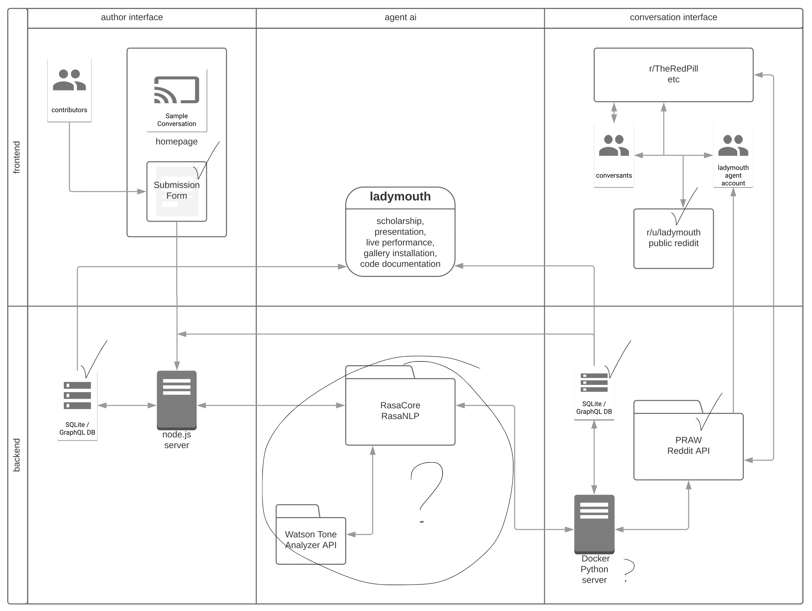

# Seminar Weekly Agenda

## 26_Nov Agenda

1. Check-ins > Send location reminder email
    1. FYIs: update to reader, just Amoore not Steyerl on 17 Dec
    1. Quick temp checks
1. Code Workshop >> 1st Hour
    1. Xi
    1. Niels N
1. Discussion 11:30: Critical AI Skills & Tools with 3D Composition Seminar
    1. Sarah: how we/i work re this topic
    1. Shu: What is a skill vs a tool
    1. Tips & Approaches
    1. Analog prompting workshop
        1. write an analog prompt   
        1. share & discuss: skill or tool? 
        1. trade & rewrite together (save as templates for later use)
1. Checkouts
    1.  End 15 min early for dept meeting
    1. 
 
### Critical AI Skills & Tools @ Computer Lab

How do we work so far around this topic?

#### Problems

- How are large models and agents shaping how you work? Do you use them as skills/tools? (Shu) What is a SKILL, what is a TOOL? 
- Buggy, biased, boring code. Hard to revisit. Locks you in to vibe coding. 
- softwares shaped by genAI tools, cultural technical pressure on the tools depending on the trend  
- Even if you say I will DIY, the programs pressure you to use it or change how they work

...There are ways to learn to navigate these spaces, critically

#### Tips for critical prompting 

>> Choose based on values, project goals, context

    - What are the stakes for this use case?
    - What are my research questions? 

>> Choose whether or not to use (based on values and context)

- Values: e.g. civilklaus, less evil, environmental impact, open source, digital sovereignity etc.

- Context: 
    - What are the boundaries of the task? 
    - Who does this impact down the line?     
    - Can a friend answer this question? 
    - Can a normal search result answer?

>> Choose how to use (based on project goals, priorities)

- Project goals and priorities: 
    - Meeting a deadline, conquering bureaucracy? 
    - Expanding creative practice, engaging in a process?
    - Finding resources, gathering info? 

>> Choose which tools to use

    - Where is the tool's dataset from, what's in it, for what purpose was it originally designed? (sometimes it's hard to find out but possible!)
    - Open source? Environmental impact? Author and artist rights? Built on datasets scraped from work like our own
    => Purpose-fit
    => Get to know details about many options as possible, via datasheets and whitepapers

>> Choose for which parts to use
    - Break down into modular parts with 'pseudocode' 
    - Make a project map to understand what you know and don't know 
    => more efficient prompting and customizable design 
    => creative agency and responsibility

#### analog prompt workshop:   

- write a prompt on paper for your project   
- share & discuss: skill or tool? mix up/put in a hat  
- trade & rewrite together (using kinds of prompts discussed below)
- (save as templates for later use) 

#### Kinds of prompts (Skill vs Tool...)

- write an app/project for you
- review sections of code, to troubleshoot or ask questions about
- explain concepts from programming, computation, or modeling that you want to understand better
- give code examples to help illustrate those concepts
- compose prompts for creative coding exercises

(from a study of how computer science students used ChatGPT)

[Critical AI Tutorials](https://p5js.org/tutorials/criticalAI1-chatting-with-about-code/)

## 19_Nov Agenda

1. Check-ins
    1. Temp check
    1. Recap Ting's workshop
    1. P4E timings
1. Discussion
    1. Recap special session with Katrin's seminar
    1. Morrison & Britton
1. Code Workshop
    1. Kylie & Daniel
    1. **Break**
1. Coworking / Projects
    1. Github / Terminal / Python / Other
    1. Group/Own Projects
1. Checkouts & FYIs
    1. 

## 12_Nov Agenda

1. Check-ins
    1. Temp check: Wonders, worries, wows, & works
        1. [common.garden @ solitude](https://garden.akademie-solitude.de/)
    1. FYIs
    1. Follow-ups from last time: What is Python?
    1. Workshop: Ollama setup
1. Discussion: Strings & Sourc(ery)
1. Code Workshop 
    1. Isabella & Amber
    1. *Break in between*
1. Coworking / Projects
    1. Pseudocode to Code-Code
    1. Software setup: Running Code, Using Github 
1. Check-outs
    1. FYIs
    1. Garden/shelf (save for later)

## 02_Oct-29 Agenda 

1. Check-ins
    1. FYI: Change of scheduling for next week, updated syllabus, 'co-working' days
    1. FYI: End 15 min early
    1. Lab Guide & Card Access
1. Reading Discussion - Variables & Naming (Keeling, Baraka, Blackwell)
    1. What is it arguing? How is it arguing it?
    1. What parts interested/stood out to you? What surprised you? What confused you?
    1. What felt most relevant to your practice?
1. Code Workshops
    1. Alysha & Luka (**Break in between?**)
    1. Variables
    1. Loops
    1. Conditionals
    1. Comments
1. Break, if not before
1. Group Work
    1. Review & Troubleshooting as needed
1. Check-Out: End early
    1. Change of plans! Class *NOT* TUESDAY!
    1. *What snippet of code will you build first?*
    1. Next readings, do you have what you need and how will you find it?

---

### Pseudocode 

If you were going to instruct me to make a salad, what would you say? Where would you start, if I know nothing, if I've never made anything before. 

Is it enough to tell me to chop vegetables? Would you say pick up knife, put knife down? 

Would you write that over and over, or maybe write it once then say, do that X times? Like in a loop?

Programming is based on a few simple concepts that we use outside of code, they're all instructions, i.e... **Control structures**

- Calculations (add these or compare these, aka operands: + - * / )
- Conditionals (Decisions) (this or that, this and that, if this/then that, booleans != > < )
- Loops (do this until I say stop) (for loop, while loop)
- Definitions (this is that, aka variables, the stuff you're doing all of the above to)
- Data Structures (which hold multiples of the you're doing it to, e.g. an ingredients list)

You can write your entire program in pseudocode (or plain language) before you begin to write it in any progrmaming language. 

### Variables

### Loops

### Conditionals

### Basic software setup for coding

- A program to write code in (text editor)
- A place to run the code (terminal)

Can add more from there

- Libraries, tools, development software, etc.

See also [FYI: Getting Started Coding](fyi_getting-started.md)

---

## 01_Oct-22 Agenda 

1. Opening Check-In & Introductions
2. Intro to Course & Lab 
3. **Break**
4. Code Workshop & Discussion
5. Closing Check-In

---

1. Opening Check-In & Introductions
    1. Write down: Name, @github, (optional) pronouns, Offering (What skills do you bring, can you share?), Seeking - Hoping to learn this semester?
    1. Share introductions & vibe check
1. Intro to Course & Lab 
    1. Syllabus FYIs: 
        1. Schedule quirks
        1. Seminar format, workshops, readings, requirements
        1. Sign up for workshop slots 2/week
    1. Lab Guide
    1. Community Commitments
    1. After today, let Sarah know whether:
        1. You will stay in the course
        1. You want a printed course reader
1. **Break**
1. Code Workshop & Discussion
    1. Project mapping brainstorm - with example
    1. Experiments with pseudocode
    1. *(break if needed)* 
    1. Basic software setup for coding
    1. Sample code workshop (can push to next week)
1. Closing Check-In
    1. Readings for next week
    1. Questions, concerns, comments, ideas?

---

### Project mapping brainstorm

Think of an idea, don’t think of code yet. Discuss with us your project idea and what tools and language(s) you might use. Focus on a section of your map where you want to start. 

Post your sketch in the lab.

I. Imagine your project (no coding necessary) What do you want to make? Why does it matter to you? Who is it for?
II. Map it out. What features will you build? How do they connect? What tools will you use? 
II.  Write pseudocode (#comments in plain language)
III. Try some tutorials, find examples
IV. Only then start coding (one section at a time)

<!-- ## Template

## Date Agenda

1. Check-ins
    1. FYIs/Followups
1. Discussion
    1. 
1. Code Workshop
    1. 
    1. **Break**
1. Coworking / Projects
    1.
1. Checkouts & FYIs
    1.  -->