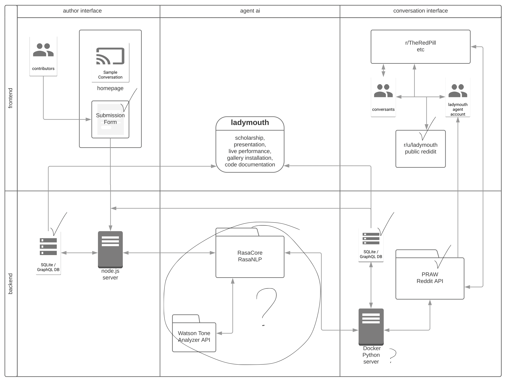

# Seminar Weekly Agenda

## 02_Oct-29 Agenda 

1. Check-ins
    1. FYI: Change of scheduling for next week, updated syllabus
    1. FYI: End 15 min early
1. Reading Discussion - Variables & Naming (Keeling, Baraka, Blackwell)
    1. What is it arguing? How is it arguing it?
    1. What parts interested/stood out to you? What surprised you? What confused you?
    1. What felt most relevant to your practice?
1. Code Workshops
    1. Alysha & Luka (**Break in between?**)
    1. Variables
    1. Loops
    1. Conditionals
    1. Comments
1. Break, if not before
1. Group Work
    1. Pseudocode to Code-Code
    1. Software setup: Running Code, Using Github 
    1. Review & Troubleshooting as needed
1. Check-Out: End early
    1. Change of plans! Class *NOT* TUESDAY!
    1. *What snippet of code will you build first?*
    1. Next readings, do you have what you need and how will you find it?

---

### Pseudocode 

If you were going to instruct me to make a salad, what would you say? Where would you start, if I know nothing, if I've never made anything before. 

Is it enough to tell me to chop vegetables? Would you say pick up knife, put knife down? 

Would you write that over and over, or maybe write it once then say, do that X times? Like in a loop?

Programming is based on a few simple concepts that we use outside of code, they're all instructions, i.e... **Control structures**

- Calculations (add these or compare these, aka operands: + - * / )
- Conditionals (Decisions) (this or that, this and that, if this/then that, booleans != > < )
- Loops (do this until I say stop) (for loop, while loop)
- Definitions (this is that, aka variables, the stuff you're doing all of the above to)
- Data Structures (which hold multiples of the you're doing it to, e.g. an ingredients list)

You can write your entire program in pseudocode (or plain language) before you begin to write it in any progrmaming language. 

### Variables

### Loops

### Conditionals

### Basic software setup for coding

- A program to write code in (text editor)
- A place to run the code (terminal)

Can add more from there

- Libraries, tools, development software, etc.

See also [FYI: Getting Started Coding](fyi_getting-started.md)

---

## 01_Oct-22 Agenda 

1. Opening Check-In & Introductions
2. Intro to Course & Lab 
3. **Break**
4. Code Workshop & Discussion
5. Closing Check-In

---

1. Opening Check-In & Introductions
    1. Write down: Name, @github, (optional) pronouns, Offering (What skills do you bring, can you share?), Seeking - Hoping to learn this semester?
    1. Share introductions & vibe check
1. Intro to Course & Lab 
    1. Syllabus FYIs: 
        1. Schedule quirks
        1. Seminar format, workshops, readings, requirements
        1. Sign up for workshop slots 2/week
    1. Lab Guide
    1. Community Commitments
    1. After today, let Sarah know whether:
        1. You will stay in the course
        1. You want a printed course reader
1. **Break**
1. Code Workshop & Discussion
    1. Project mapping brainstorm - with example
    1. Experiments with pseudocode
    1. *(break if needed)* 
    1. Basic software setup for coding
    1. Sample code workshop (can push to next week)
1. Closing Check-In
    1. Readings for next week
    1. Questions, concerns, comments, ideas?

---

### Project mapping brainstorm

Think of an idea, don’t think of code yet. Discuss with us your project idea and what tools and language(s) you might use. Focus on a section of your map where you want to start. 

Post your sketch in the lab.

I. Imagine your project (no coding necessary) What do you want to make? Why does it matter to you? Who is it for?
II. Map it out. What features will you build? How do they connect? What tools will you use? 
II.  Write pseudocode (#comments in plain language)
III. Try some tutorials, find examples
IV. Only then start coding (one section at a time)

